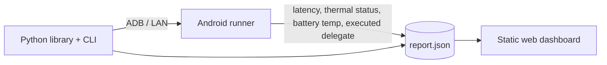

# JITTER

**Root-cause analysis for on-device ML latency.**

Jitter reruns your model benchmark under four controlled conditions and tells you *why* it is slow or inconsistent on a real phone: warmup, thermal throttling, delegate fallback, background load, or a genuine regression.

> **Status: design phase.** Nothing in this repository is released yet. The CLI, API and report schema below are the design target and will change. Every number in the docs and on the website is simulated until the first measured case study is published. "Jitter" is a working name.

---

## The problem

A single latency number from a phone benchmark is nearly meaningless:

- The first iterations are slow (JIT, caches, lazy initialization).
- The phone heats up and the SoC throttles, so run 50 is slower than run 5.
- NNAPI can silently fall back to the CPU, so the accelerator you requested is not the one that ran.
- Other processes steal time in bursts.
- And occasionally, your change really did make the model slower.

Existing tools measure well. They do not tell you which of these five things you are looking at. Jitter does.

## How it works

Each diagnosis is four controlled reruns of the same benchmark:

| # | Rerun | Held constant | Varied | Isolates |
|---|-------|---------------|--------|----------|
| 1 | Cold vs warm | model, input, delegate | fresh process vs warmed-up process | one-time startup cost |
| 2 | Cooldown | model, input, delegate | phone rests until thermal state recovers | thermal throttling |
| 3 | Delegate swap | model, input | CPU, GPU, NNAPI; records the delegate that actually executed | silent delegate fallback |
| 4 | Quiet device | model, input, delegate | background load controlled | device noise |

The outputs are compared statistically and classified:

| Label | Signature |
|-------|-----------|
| `warmup_drift` | First *k* iterations exceed the steady-state median by more than 3 MAD, then converge |
| `thermal_throttling` | Monotonic rolling-median increase, thermal status at or above moderate, recovery after cooldown |
| `delegate_fallback` | Requested delegate differs from executed delegate, or a step change in median with unchanged variance |
| `background_noise` | Heavy-tailed spikes (high p99/median ratio) that vanish in the quiet-device rerun |
| `regression` | The difference persists across all four reruns |

Each verdict carries a confidence score and the evidence that produced it.

## Components



1. **Python library and CLI** (`jitter`): defines benchmarks, orchestrates the four reruns, computes statistics, classifies the result.
2. **Android runner** (Kotlin, Jetpack Compose, MVI): runs the model with LiteRT or ONNX Runtime Mobile in a foreground service and logs per-iteration latency, `PowerManager` thermal status and headroom, battery temperature, and the delegate that actually ran.
3. **Web dashboard** (Next.js, static): load report files to compare runs and read the verdict. Reports are parsed in the browser. There is no backend, no account and no upload.

## Planned usage

```bash
pip install jitter

# benchmark a model on a connected phone
jitter run model.tflite --device auto

# compare two runs
jitter compare before.json after.json

# run the four reruns and classify the cause
jitter diagnose after.json
```

Example output (simulated):

```
$ jitter diagnose mobilenet_v3.tflite --device pixel-7a
[1/4] cold vs warm .......... warmup 6 iters, steady-state from iter 7
[2/4] cooldown .............. median 14.1 ms after 240 s rest (was 33.0 ms)
[3/4] delegate swap ......... requested NNAPI, executed GPU, no fallback
[4/4] quiet device .......... noise floor +/- 0.4 ms
verdict: thermal_throttling   confidence 0.93
drift: +2.3x over 90 s (95% CI 2.1 to 2.5x)
```

Planned exit codes for CI: `0` ok, `1` error, `2` regression detected.

## Statistics

- **Warmup detection:** change-point detection on a rolling median (CUSUM).
- **Confidence intervals:** bootstrap (percentile or BCa), 10,000 resamples.
- **Comparing runs:** Mann-Whitney U, Hodges-Lehmann shift estimate, Cliff's delta as the effect size.
- **Reporting:** median, p95 and p99 with intervals, never a bare mean.

The statistics core will be validated against synthetic latency distributions with known ground truth before any real-device claim is made.

## Report format (draft)

```json
{
  "schema_version": "0.1",
  "model": { "name": "mobilenet_v3.tflite", "sha256": "..." },
  "device": { "model": "...", "android_api": 34 },
  "runs": [
    {
      "rerun": "cold_warm",
      "delegate_requested": "NNAPI",
      "delegate_executed": "GPU",
      "samples_ms": [14.2, 14.0, 13.9],
      "telemetry": { "thermal_status": [0, 0, 1], "battery_temp_c": [31.2, 31.4, 31.9] }
    }
  ],
  "diagnosis": { "label": "thermal_throttling", "confidence": 0.93, "evidence": [] }
}
```

## Validation plan

The claim that matters is how often the engine names the right cause. The plan:

1. Inject known faults on purpose: heat the device with a load, force CPU fallback, add background bursts.
2. Run the diagnosis and record the confusion matrix across the five labels.
3. Publish the accuracy numbers, including the failures, alongside a case study on at least two physical phones.

Emulators are not used: they have no real thermal behavior and no real NNAPI.

## Roadmap

- [ ] Statistics core and desktop CLI (ONNX Runtime), tested on synthetic distributions
- [ ] Trace recorder, report schema v0.1, replay
- [ ] Android runner with the telemetry above
- [ ] Diagnosis engine with fault-injection validation
- [ ] Static web dashboard
- [ ] PyPI release, CI, documentation site
- [ ] Case study across physical devices and delegates

**Out of scope for now:** model conversion, a cloud device farm, user accounts, iOS.

## Related work

- Android Macrobenchmark and the TFLite `benchmark_model` tool measure latency well. Jitter's contribution is controlled reruns, root-cause classification and the statistics around them.
- [Flakerad](https://github.com/AyushDubey23/flakerad), by the same author, applies the same idea (controlled reruns to infer the cause) to flaky tests.

## Contributing

The project is at the design stage. Issues with ideas, device-specific thermal or delegate quirks, and statistical critique are the most useful contributions right now.

## License

MIT (planned).

## Author

Ayush ([@AyushDubey23](https://github.com/AyushDubey23))
